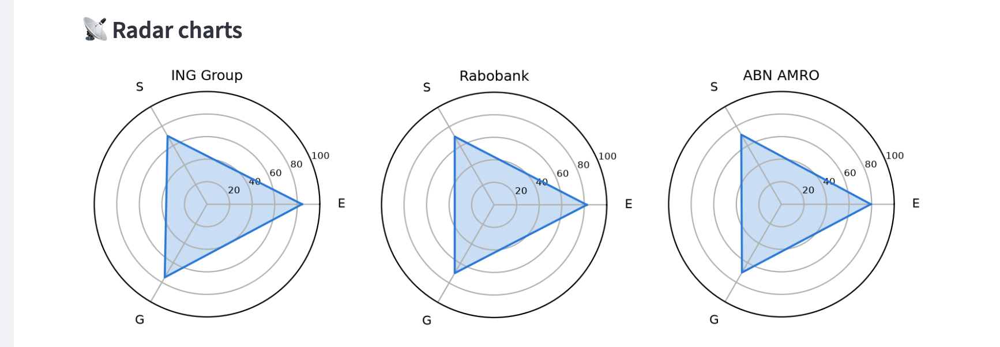
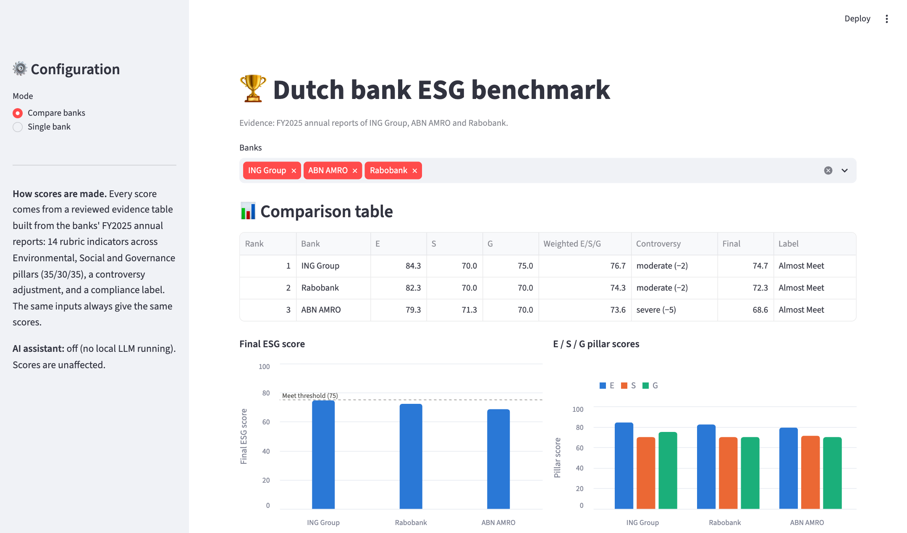
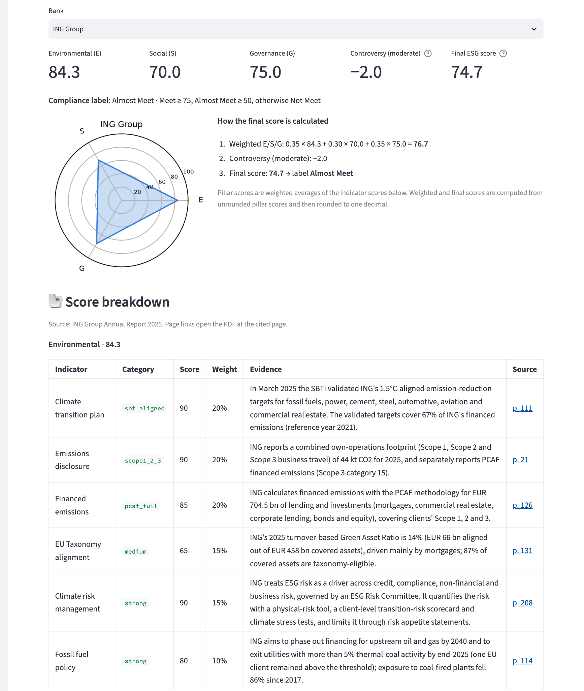
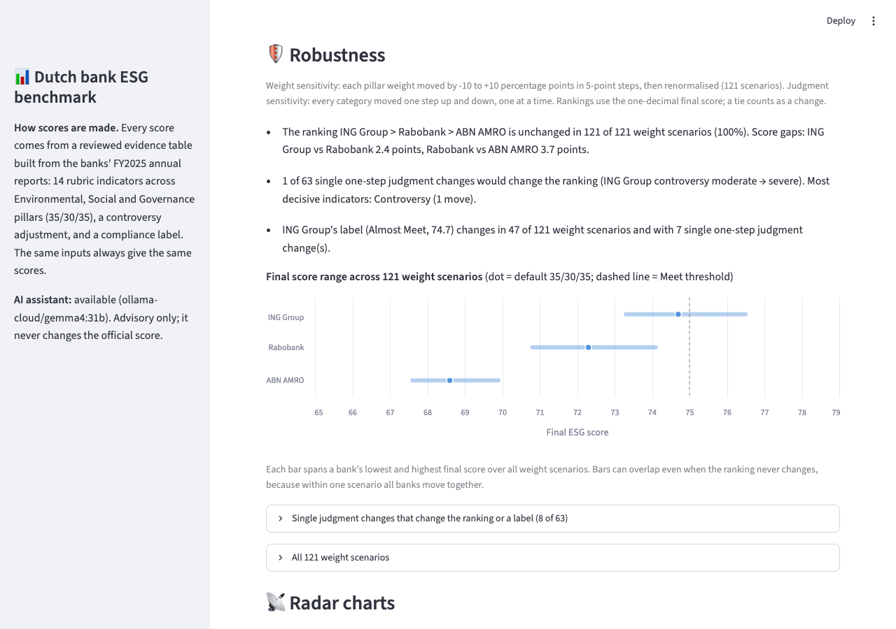

# Dutch Bank ESG Benchmark

An evidence-based ESG benchmark of ING Group, ABN AMRO and Rabobank, where every score traces back to a cited page in the bank's annual report.

**Live demo:** [dutch-bank-esg.streamlit.app](https://dutch-bank-esg.streamlit.app). The optional AI assistant is off online. If the app has been idle, it may take about 30 seconds to wake up.

## Context

- **Course project:** Columbia University industry-sponsored course project with Accenture, September–November 2025. Team project.
- **My role:**
  - Designed the ESG scoring framework: a 25-indicator rubric (14 of which are scored in this implementation) across environmental, social, and governance pillars, pillar weights (35/30/35), a controversy adjustment, and a compliance label
  - Analyzed the banks' annual, sustainability, and CSRD reports and translated regulatory disclosures into rubric categories
  - Built the interactive Streamlit dashboard (radar charts, peer comparison, score explanations) using AI coding tools
  - Presented the framework and findings to Accenture stakeholders
- **Revision (October 2026):** the scoring was rebuilt to be fully evidence-based. The original version fell back to randomly chosen rubric categories when the local LLM was unavailable and showed a simulated confidence band. Both are gone; see the [CHANGELOG](CHANGELOG.md).

## Results

Scores from the evidence table (FY2025 annual reports), default weights 35% E / 30% S / 35% G:

| Rank | Bank | E | S | G | Weighted E/S/G | Controversy | **Final** | Compliance label |
|---|---|---|---|---|---|---|---|---|
| 1 | ING Group | 84.3 | 70.0 | 75.0 | 76.7 | moderate (−2) | **74.7** | Almost Meet |
| 2 | Rabobank | 82.3 | 70.0 | 70.0 | 74.3 | moderate (−2) | **72.3** | Almost Meet |
| 3 | ABN AMRO | 79.3 | 71.3 | 70.0 | 73.6 | severe (−5) | **68.6** | Almost Meet |



**Robustness**

- **The ranking is robust.** It is unchanged in 121 of 121 weight scenarios, in which each pillar weight moves by up to ±10 percentage points. Of 63 single one-step changes to a category judgment, only one changes the ranking: ING Group's controversy moving from `moderate` to `severe`.
- **The compliance label is not robust.** ING Group (74.7) is 0.3 points below the 75-point "Meet" threshold. Its label changes in 47 of 121 weight scenarios and with any of 7 single one-step upgrades.

**Why the ranking holds:**
- ING Group scores at least as high as Rabobank on every pillar.
- Rabobank's lead over ABN AMRO comes from a higher Environmental score and a smaller controversy deduction.

## Methodology

The model scores five auditable dimensions: three pillars (**Environmental**, **Social**, **Governance**), a **controversy** adjustment, and a **compliance** label.

**1. Evidence table.** [`data/evidence/esg_evidence.csv`](data/evidence/esg_evidence.csv) holds one row per bank × indicator (3 × 15 = 45 rows). Each row has:
- a category;
- a short evidence summary;
- the source document, page number and URL;
- a review status.

All rows were proposed as drafts and confirmed by review. The rule for assigning each category is written down in [`category_definitions.md`](data/evidence/category_definitions.md).

**2. Sources.** One document per bank: its FY2025 annual report, which contains the CSRD sustainability statement (prepared under ESRS, with limited assurance from the external auditor).
- [ING Group Annual Report 2025](https://ing.com/binaries/content/assets/documents/annual-reports/2025-ing-groep-nv-annual-report.pdf)
- [ABN AMRO Bank Annual Report 2025](https://downloads.ctfassets.net/1u811bvgvthc/688tP3vcLbHAgEsUavbdMR/22bd74bf45996df3f6e76b0893ecc950/ABN_AMRO_Bank_-_Annual_Report_2025.pdf)
- [Rabobank Annual Report 2025](https://media.rabobank.com/m/5fdc5677200a9d1f/original/Annual-Report-2025.pdf)

**3. Rubric.** 14 indicators, each mapped from a category to a fixed 0–100 score in [`tools/score_engine.py`](tools/score_engine.py):

| Pillar (weight) | Indicators (weight within pillar) |
|---|---|
| Environmental (35%) | Climate transition plan (20%), emissions disclosure (20%), financed emissions (20%), EU Taxonomy alignment (15%), climate risk management (15%), fossil fuel policy (10%) |
| Social (30%) | Diversity & inclusion, labour rights, customer protection, AML maturity (25% each) |
| Governance (35%) | Board independence, ESG oversight, ESG-linked executive pay, CSRD transparency (25% each) |

An indicator marked `not_disclosed` receives the lowest score and is flagged in the UI.

**4. Controversy adjustment.** It deducts 0, 2 or 5 points for `none`, `moderate` or `severe`, based on each bank's legal-proceedings disclosures:
- `moderate`: ESG-related litigation or remediation is ongoing.
- `severe`: a new ESG-related fine, settlement or conviction in the reporting year.

Events already scored as `fined` under AML maturity or customer protection are not counted again.

**5. Final score and compliance label.**
- **Formula:** final = 0.35 × E + 0.30 × S + 0.35 × G − controversy deduction, clamped to 0–100 and rounded to one decimal.
- **Labels:** **Meet** (≥ 75), **Almost Meet** (≥ 50) or **Not Meet**, assigned from the rounded score.

**6. Sensitivity analysis.** [`tools/sensitivity.py`](tools/sensitivity.py) runs two checks:
- **Weights:** moves each pillar weight by −10/−5/0/+5/+10 percentage points and renormalises them (121 unique scenarios).
- **Judgments:** moves every category judgment one step up and down, one at a time.

A tie between banks counts as a ranking change.

**7. Optional AI assistant.** If a local LLM is running, it summarises the cited report pages and the news, suggests categories and drafts a narrative.
- It never changes a score: its suggestions are shown next to the evidence as "AI suggestion, not used in score".
- Calls use temperature 0 and a fixed seed, and responses are cached by a hash of the input.

## Screenshots

**Comparison:** scores, pillar charts and the Meet threshold.



**Single bank:** the calculation and the evidence behind every indicator, with links to the cited PDF page.



**Robustness panel**



## How to run

Requires Python 3.12. From the repository root:

```bash
python3.12 -m venv .venv
```

```bash
source .venv/bin/activate
```

```bash
pip install -r requirements.txt
```

```bash
streamlit run app_v2.py
```

The app runs fully without an LLM. To enable the optional AI assistant, install [Ollama](https://ollama.com) and pull the model:

```bash
ollama pull llama3
```

LLM settings are optional; see [`.env.example`](.env.example).

To run the tests (71 tests, no LLM or network needed):

```bash
pip install -r requirements-dev.txt
```

```bash
pytest
```

## Limitations

- **One reporting year.** The evidence reflects FY2025 annual reports only.
  - Events after the reporting year are noted in the evidence table but not scored. For example, DNB fined ABN AMRO in July 2026.
  - Rabobank's financed emissions figures relate to its 2024 portfolio.
- **Analyst judgment.**
  - Categories are judgments against written definitions, not mechanical extractions.
  - Some thresholds are conventions; for example, the EU does not define high or low Green Asset Ratio bands.
  - The sensitivity analysis shows which judgments matter, but a different analyst could reasonably differ on borderline rows. These are recorded in the `notes` column.
- **Self-reported disclosures.** The evidence is what the banks report. The sustainability statements carry limited, not reasonable, assurance.
- **Limited differentiation.** 8 of the 15 indicators have the same category for all three banks, so the ranking rests on a few indicators. Compliance labels near the 75 threshold are sensitive to weights and single judgments.
- **AI assistant.** The optional assistant was tested with a stub, not against a running model, and is not used for scoring.
- **Not investment advice.** This is a course project benchmark, not an investment or credit recommendation.

## Project structure

```text
├── app_v2.py                    # Streamlit UI
├── server.py                    # Orchestrator: scores, optional context, optional AI assistant
├── agents/
│   ├── esg_agent.py             # LLM category suggestions (advisory only)
│   ├── final_writer.py          # LLM narrative report (advisory only)
│   └── news_agent.py            # LLM news summary (advisory only)
├── tools/
│   ├── score_engine.py          # Rubric, pillar scores, controversy, compliance label
│   ├── evidence.py              # Loads and validates the evidence table
│   ├── sensitivity.py           # Weight and judgment sensitivity analysis
│   ├── local_llm.py             # Optional Ollama client (temperature 0, fixed seed, cache)
│   ├── pdf_fetcher.py           # Downloads the cited annual report
│   ├── pdf_summarizer.py        # LLM report summary (advisory only)
│   ├── free_news.py             # Google News RSS (context only)
│   ├── yahoo_client.py          # Yahoo Finance snapshot (context only)
│   ├── dutch_banks.py           # Bank names and aliases
│   └── radar_chart.py           # Radar chart
├── data/evidence/
│   ├── esg_evidence.csv         # 45 confirmed evidence rows
│   └── category_definitions.md  # Rules for assigning each category
├── tests/                       # pytest suite
├── docs/
│   ├── ESG_FIX_SPEC.md          # Revision specification
│   └── screenshots/
├── requirements.txt
├── requirements-dev.txt
└── CHANGELOG.md
```

## License

MIT, see [LICENSE](LICENSE).
