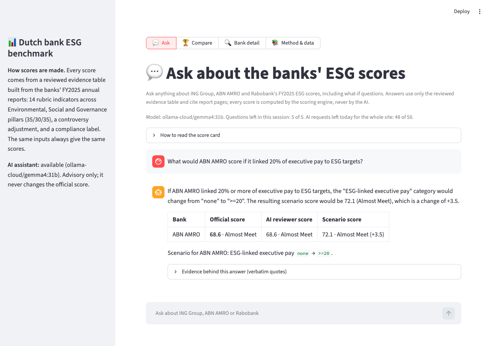

# Dutch Bank ESG Benchmark

[](https://github.com/SiuLok6San/ESG-Insight-Platform/actions/workflows/tests.yml)

An evidence-based ESG benchmark of ING Group, ABN AMRO and Rabobank, where every score traces back to a cited page in the bank's annual report.

**Live demo:** [dutch-bank-esg.streamlit.app](https://dutch-bank-esg.streamlit.app). The site has four sections across the top: **Ask** (a chat about the three banks' ESG scores, including what-if questions; 5 questions per visit and 50 AI requests per day for the whole site), **Compare**, **Bank detail** and **Method & data**. Links such as `?section=method` open a section directly. If the app has been idle, it may take about 30 seconds to wake up.

## Context

- **Course project:** Columbia University industry-sponsored course project with Accenture, September–November 2025. Team project.
- **My role** ([@SiuLok6San](https://github.com/SiuLok6San)):
  - Designed the ESG scoring framework: a 25-indicator rubric (14 of which are scored in this implementation) across environmental, social, and governance pillars, pillar weights (35/30/35), a controversy adjustment, and a compliance label
  - Analyzed the banks' annual, sustainability, and CSRD reports and translated regulatory disclosures into rubric categories
  - Built the interactive Streamlit dashboard (radar charts, peer comparison, score explanations) using AI coding tools
  - Presented the framework and findings to Accenture stakeholders
- **Yuqing's role** ([@yuqingtao1103](https://github.com/yuqingtao1103)):
  - Reviewed disclosures and built indicators: reviewed European banks' sustainability disclosures and translated EU disclosure requirements into validated ESG indicators for comparing the banks' reporting
  - Checked data quality: identified gaps and inconsistencies across the banks' ESG reports, improving the reliability and auditability of the reported data
- **Revision (October 2026):** the course prototype used placeholder scores when no local LLM was available. The revision rebuilt the scoring to be fully evidence-based and replaced the prototype's placeholder confidence band with a sensitivity analysis; see the [CHANGELOG](CHANGELOG.md).

## Results

Scores from the evidence table (FY2025 annual reports), default weights 35% E / 30% S / 35% G:

| Rank | Bank | E | S | G | Weighted E/S/G | Controversy | **Final** | Compliance label |
|---|---|---|---|---|---|---|---|---|
| 1 | ING Group | 84.3 | 70.0 | 75.0 | 76.7 | moderate (−2) | **74.7** | Almost Meet |
| 2 | Rabobank | 82.3 | 70.0 | 70.0 | 74.3 | moderate (−2) | **72.3** | Almost Meet |
| 3 | ABN AMRO | 79.3 | 71.3 | 70.0 | 73.6 | severe (−5) | **68.6** | Almost Meet |


**Robustness**

- **The ranking is robust.** It is unchanged in 121 of 121 weight scenarios, in which each pillar weight moves by up to ±10 percentage points. Of 63 single one-step changes to a category judgment, only one changes the ranking: ING Group's controversy moving from `moderate` to `severe`.
- **The compliance label is not robust.** ING Group (74.7) is 0.3 points below the 75-point "Meet" threshold. Its label changes in 47 of 121 weight scenarios and with any of 7 single one-step upgrades.

**Why the ranking holds:**
- ING Group scores at least as high as Rabobank on every pillar.
- Rabobank's lead over ABN AMRO comes from a higher Environmental score and a smaller controversy deduction.

**AI evidence review** (Ollama Cloud, `gemma4:31b`, run on 17 October 2026; not used in score)

An independent LLM checked each of the 45 evidence rows against its single cited page:
- **Evidence summary:** fully supported in 32 rows, partly supported in 13, not supported in 0. Most "partly" verdicts come from summaries that also use facts from pages cited in the analyst's notes, which the reviewer does not see.
- **Category:** the same as the analyst's in 39 of 45 rows.
  - 4 of the 6 differences come from facts on note-cited pages (e.g. gender pay gap figures printed on the next page).
  - The other 2 are judgment calls already flagged during the evidence review: Rabobank's risk management (`strong` vs `full`), and Rabobank's board independence, which the report states only as compliance with the Dutch Corporate Governance Code, without a headcount.
- **Quotes:** 42 of 45 were found verbatim on the cited page. The other 3 were stitched together from table cells or shortened, and the check correctly rejected them.

## Methodology

The model scores five auditable dimensions: three pillars (**Environmental**, **Social**, **Governance**), a **controversy** adjustment, and a **compliance** label.

**1. Evidence table.** [`data/evidence/esg_evidence.csv`](data/evidence/esg_evidence.csv) holds one row per bank × indicator (3 × 15 = 45 rows). Each row has:
- a category;
- a short evidence summary;
- a **verbatim quote** from the report;
- the source document, page number and URL;
- a review status.

All rows were proposed as drafts and confirmed by review.
- **Every quote is checked against the PDF.** [`scripts/verify_quotes.py`](scripts/verify_quotes.py) downloads the reports and checks each of the 88 excerpts on its page. A quote can span two pages of the same report (marked like `[p. 138]`). Results are saved in `data/evidence/quote_check.csv`, and the tests fail if a quote is edited without re-running the check.
- **Re-check of flagged rows.** The 17 rows flagged by the AI evidence review (section 8) were re-read in October 2026; see [`docs/evidence_recheck.md`](docs/evidence_recheck.md). 15 hold up once the full evidence is read, and 2 were judgment calls that the analysts decided to keep as confirmed. No category changed; one summary and one note were reworded.
- **Numbers behind the numeric indicators.** For the Green Asset Ratio, board independence and ESG-linked pay, the figure stated in each quote gives the same category as the analysts chose, except where no figure is stated (Rabobank board independence). [`docs/scoring_options.md`](docs/scoring_options.md) also shows the effect of continuous scoring and of the open judgment calls; none changes a label or the ranking. The rule for assigning each category is written down in [`category_definitions.md`](data/evidence/category_definitions.md).

**2. Sources.** One document per bank: its FY2025 annual report, which contains the CSRD sustainability statement (prepared under ESRS, with limited assurance from the external auditor).
- [ING Group Annual Report 2025](https://ing.com/binaries/content/assets/documents/annual-reports/2025-ing-groep-nv-annual-report.pdf)
- [ABN AMRO Bank Annual Report 2025](https://downloads.ctfassets.net/1u811bvgvthc/688tP3vcLbHAgEsUavbdMR/22bd74bf45996df3f6e76b0893ecc950/ABN_AMRO_Bank_-_Annual_Report_2025.pdf)
- [Rabobank Annual Report 2025](https://media.rabobank.com/m/5fdc5677200a9d1f/original/Annual-Report-2025.pdf)

**3. Rubric.** 14 indicators, each mapped from a category to a fixed 0–100 score in [`tools/score_engine.py`](tools/score_engine.py):

| Pillar (weight) | Indicators (weight within pillar) |
|---|---|
| Environmental (35%) | Climate transition plan (20%), emissions disclosure (20%), financed emissions (20%), EU Taxonomy alignment (15%), climate risk management (15%), fossil fuel policy (10%) |
| Social (30%) | Diversity & inclusion, labour rights, customer protection, AML maturity (25% each) |
| Governance (35%) | Board independence, ESG oversight, ESG-linked executive pay, CSRD transparency (25% each) |

An indicator marked `not_disclosed` receives the lowest score and is flagged in the UI.

**4. Controversy adjustment.** It deducts 0, 2 or 5 points for `none`, `moderate` or `severe`, based on each bank's legal-proceedings disclosures:
- `moderate`: ESG-related litigation or remediation is ongoing.
- `severe`: a new ESG-related fine, settlement or conviction in the reporting year.

Events already scored as `fined` under AML maturity or customer protection are not counted again.

**5. Final score and compliance label.**
- **Formula:** final = 0.35 × E + 0.30 × S + 0.35 × G − controversy deduction, clamped to 0–100 and rounded to one decimal.
- **Labels:** **Meet** (≥ 75), **Almost Meet** (≥ 50) or **Not Meet**, assigned from the rounded score.

**6. Sensitivity analysis.** [`tools/sensitivity.py`](tools/sensitivity.py) runs two checks:
- **Weights:** moves each pillar weight by −10/−5/0/+5/+10 percentage points and renormalises them (121 unique scenarios).
- **Judgments:** moves every category judgment one step up and down, one at a time.

A tie between banks counts as a ranking change.

**7. Optional AI assistant (chat).** The first page of the app is a chat about the three banks. It answers questions such as "Which bank is strongest on climate?" and what-if questions such as "What would ABN AMRO score if it linked 20% of executive pay to ESG targets?" (code in [`agents/chat_agent.py`](agents/chat_agent.py)). Each question goes through three steps:
1. **Understand the question**: which banks and indicators it is about.
   - Ordinary questions are handled **in code**, from bank names and topic keywords. Follow-ups like "And Rabobank?" or "How does it do on that?" keep the previous bank or topic.
   - Only a what-if question costs one short LLM call, to map the hypothetical to rubric category changes. Every value is checked against the rubric; anything else is dropped and reported.
2. **Compute the scores** (no LLM):
   - the official score;
   - the **AI reviewer score**: the same engine applied to the categories of the **blind AI review** (section 8), which rated each row from the report pages and the written definitions only, without seeing the analysts' categories;
   - for what-if questions, a **scenario score** and any change in the ranking.
3. **Answer** (one streamed LLM call): the model may use only the evidence rows, verbatim quotes and computed scores, and must cite pages. Page citations that are not in the evidence it was given are flagged under the answer.

Each answer comes with a score card and the verbatim quotes it could use. The model never produces a number, and only the official score is used in the benchmark.
- The model is Ollama Cloud `gemma4:31b` online, or a local Ollama server. Calls use temperature 0 and a fixed seed, and responses are cached by a hash of the input.
- In a live test on 18 October 2026, the first words of an answer appeared after about 3 seconds and the full answer after about 4 seconds.
- To stay within the free API quota, the online demo allows 5 questions per visit and 50 AI requests per day for the whole site (questions and narrative reports together). The per-visit limit resets when the page is reloaded; the daily limit does not, and resets at midnight UTC or when the app restarts. Answers served from the cache do not count.
- A narrative report for one bank can be written on request from the Bank detail page.
- **Numbers and pages are checked.** After each answer, code flags any page citation that is not in the evidence the model was given and any number that appears in neither the scores nor that evidence. Page numbers and small counts are not checked.
- **Few, short requests; fail fast when busy.** The free Ollama Cloud tier answers one request at a time per key, with a short queue, and a request the app has given up on stays in that queue. So the chat keeps requests to a minimum:
  - an ordinary question makes **one** model call and a what-if question two;
  - answers are capped at 600 tokens (`LLM_CHAT_MAX_TOKENS`);
  - a call that timed out is not retried, because it may still be queued.
  - If the service is busy, the visitor sees "The free AI service is busy right now" and the request is not counted. Other settings: `LLM_CHAT_TIMEOUT` and `LLM_CHAT_RETRIES`.

**8. AI evidence review.** An independent second check of the evidence table, run once offline with [`scripts/review_evidence.py`](scripts/review_evidence.py):
- For each row, an LLM is given the cited PDF page (and no other page), the analysts' summary and category, and the written definitions. It answers three things: does the page support the evidence summary; which category it would assign; which passage backs its answer. Because it sees the analysts' category, its category is a second opinion rather than a blind rating.
- The passage must be quoted verbatim, and the code checks that it really appears on the page, so an invented quote is flagged rather than trusted.
- Results are saved in `data/evidence/ai_review.csv` and shown in the app as "AI check, not used in score". Disagreements are prompts to re-check a row; they never change a category.
- **Blind review** (`python -m scripts.review_evidence --blind`, code in [`tools/blind_review.py`](tools/blind_review.py)): a second pass in which the prompt contains only the indicator, the category definitions and the text of the pages the row quotes. There is no analysts' category or summary, and the bank isn't named.
  - Run on 18 October 2026 with `gemma4:31b`, it chose the analysts' category on **43 of 45 rows**. The review that was shown the analysts' category agreed on 39, but it also saw fewer pages, so the two figures are not a clean measure of anchoring.
  - The two disagreements (both Rabobank) are listed in [`docs/blind_review.md`](docs/blind_review.md) and decided in the re-check worksheet. Results are saved in `data/evidence/ai_blind_review.csv`.
- The client in [`tools/llm_provider.py`](tools/llm_provider.py) works with any OpenAI-compatible API: Ollama Cloud by default, or Gemini, Groq or a local Ollama by configuration.

## Screenshots

**Ask:** a what-if question answered with the official, AI reviewer and scenario scores, all computed by the scoring engine.



**Compare:** scores, pillar charts and the Meet threshold.


**Bank detail:** the calculation and the evidence behind every indicator, with links to the cited PDF page and the verbatim quotes.


**Robustness panel**


## How to run

Requires Python 3.12. From the repository root:

```bash
python3.12 -m venv .venv
```

```bash
source .venv/bin/activate
```

```bash
pip install -r requirements.txt
```

```bash
streamlit run app_v2.py
```

The app runs fully without an LLM. To enable the optional AI assistant, either put an Ollama Cloud API key in `.env` as `OLLAMA_API_KEY` (create one at [ollama.com/settings/keys](https://ollama.com/settings/keys)), or install [Ollama](https://ollama.com) and pull a local model:

```bash
ollama pull llama3
```

LLM settings are optional; see [`.env.example`](.env.example). On Streamlit Community Cloud, add `OLLAMA_API_KEY` under the app's **Settings → Secrets** instead of a `.env` file.

To run the tests (162 tests, no LLM or network needed):

```bash
pip install -r requirements-dev.txt
```

```bash
pytest
```

To re-run the AI evidence review, put an Ollama Cloud API key in `.env` as `OLLAMA_API_KEY` (see [`.env.example`](.env.example)). Then:

```bash
python -m scripts.review_evidence
```

To re-check every verbatim quote against the PDFs (downloads the three reports, no API key needed), or to regenerate the scoring-options analysis:

```bash
python -m scripts.verify_quotes
```

```bash
python -m scripts.scoring_options --write
```

## Limitations

- **One reporting year.** The evidence reflects FY2025 annual reports only.
  - Events after the reporting year are noted in the evidence table but not scored. For example, DNB fined ABN AMRO in July 2026.
  - Rabobank's financed emissions figures relate to its 2024 portfolio.
- **Analyst judgment.**
  - Categories are judgments against written definitions, not mechanical extractions.
  - Some thresholds are conventions; for example, the EU does not define high or low Green Asset Ratio bands.
  - The sensitivity analysis shows which judgments matter, but a different analyst could reasonably differ on borderline rows. These are recorded in the `notes` column.
- **Self-reported disclosures.** The evidence is what the banks report. The sustainability statements carry limited, not reasonable, assurance.
- **Limited differentiation.** 8 of the 15 indicators have the same category for all three banks, so the ranking rests on a few indicators. Compliance labels near the 75 threshold are sensitive to weights and single judgments.
- **AI assistant.** Its answers come from a language model and can be wrong or incomplete, even though the scores are computed by code and citations outside the evidence are flagged. The AI reviewer score reflects one model reading the quoted pages of each row; it can miss evidence elsewhere in the report and applies the definitions literally (e.g. it counted a 2023 competition-law fine against Rabobank as a FY2025 ESG controversy). Both are advisory and never used for the official scores.
- **Not investment advice.** This is a course project benchmark, not an investment or credit recommendation.

## Project structure

```text
├── app_v2.py                    # Streamlit UI
├── server.py                    # Orchestrator: scores, sensitivity, optional AI assistant
├── agents/
│   ├── chat_agent.py            # Chat: route the question, compute scores, stream a cited answer
│   └── final_writer.py          # LLM narrative report on request (advisory only)
├── tools/
│   ├── score_engine.py          # Rubric, pillar scores, controversy, compliance label
│   ├── evidence.py              # Loads and validates the evidence table
│   ├── sensitivity.py           # Weight and judgment sensitivity analysis
│   ├── ai_review.py             # AI evidence review: prompts, quote check, results file
│   ├── blind_review.py          # Blind AI review: rates each row without the analysts' category
│   ├── llm_provider.py          # OpenAI-compatible client (Ollama Cloud, Gemini, Groq, local Ollama)
│   ├── local_llm.py             # AI assistant client (Ollama Cloud or local Ollama; temperature 0, fixed seed, cache)
│   ├── pdf_fetcher.py           # Downloads the cited annual report
│   ├── quota.py                 # Site-wide daily cap on AI requests
│   ├── quotes.py                # Verbatim quotes: parsing and checking against PDF pages
│   ├── dutch_banks.py           # Bank names and aliases
│   └── radar_chart.py           # Radar chart
├── data/evidence/
│   ├── esg_evidence.csv         # 45 confirmed evidence rows, each with a verbatim quote
│   ├── quote_check.csv          # Result of checking every quote against its PDF page
│   ├── ai_review.csv            # Offline AI evidence review results
│   ├── ai_blind_review.csv      # Blind AI review results (used for the AI reviewer score)
│   └── category_definitions.md  # Rules for assigning each category
├── scripts/
│   ├── review_evidence.py       # Offline AI evidence review
│   ├── verify_quotes.py         # Checks every quote against its PDF page
│   └── scoring_options.py       # Number-based categories, continuous scoring, judgment calls
├── tests/                       # pytest suite
├── docs/
│   ├── ESG_FIX_SPEC.md          # Revision specification
│   ├── evidence_recheck.md      # Re-check worksheet for the 17 flagged rows and the blind review
│   ├── blind_review.md          # Generated: blind AI review agreement and disagreements
│   ├── scoring_options.md       # Generated by scripts/scoring_options.py
│   └── screenshots/
├── requirements.txt
├── requirements-dev.txt
└── CHANGELOG.md
```

## License

MIT, see [LICENSE](LICENSE).
